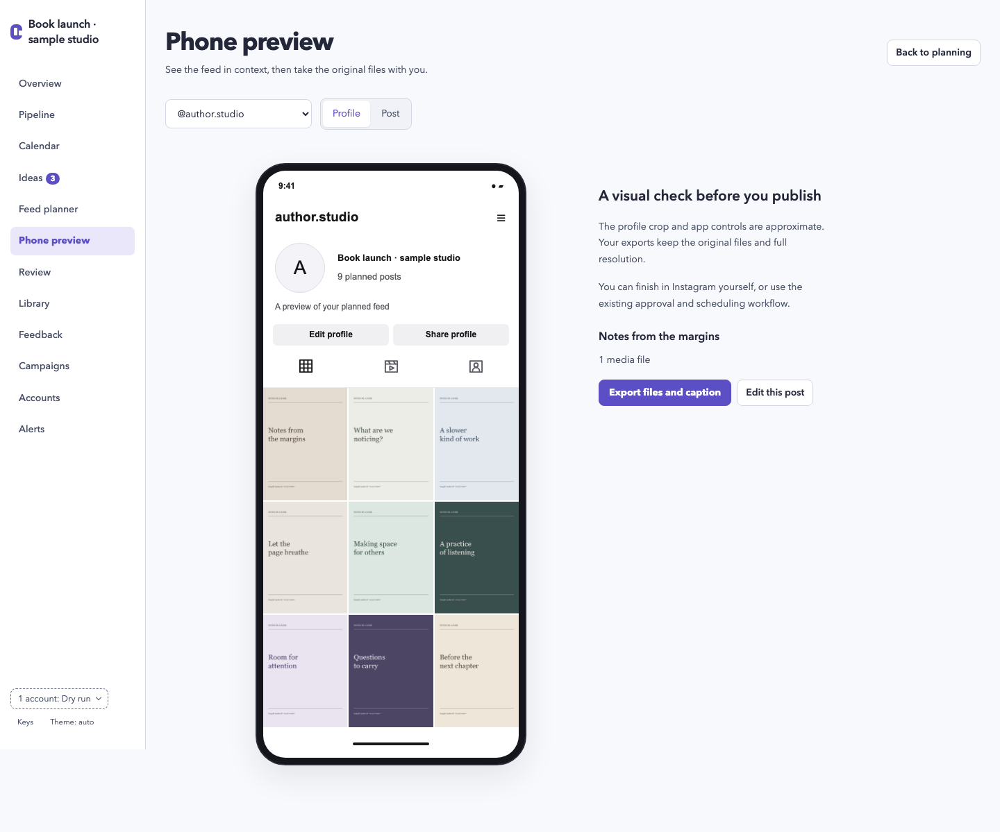
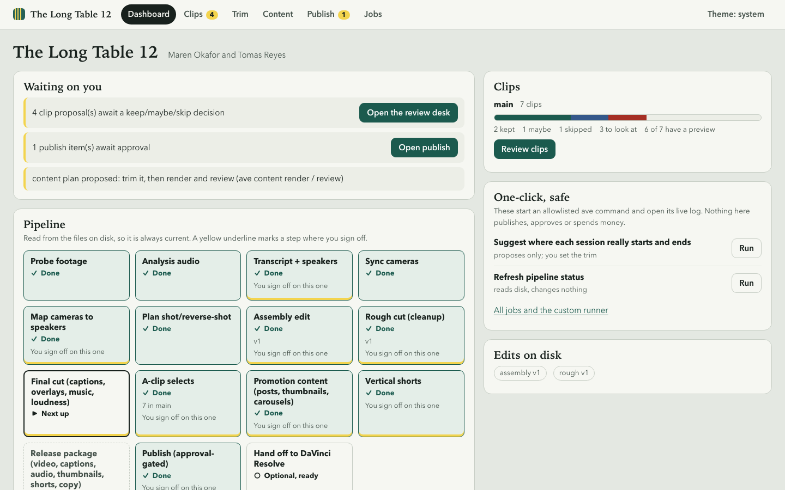

# Agentic Video Editor

A local creative studio for source material, podcast editing, social content, review and release. Overview, Pipeline, Calendar and Feed planner connect the work to its platform previews and asset library. A phone preview and full-resolution export support finishing posts in Instagram yourself. External agents supply creative judgment through the CLI, skills and a bounded MCP interface.

## Open the studio

```sh
uv sync --all-extras
.venv/bin/ave doctor
.venv/bin/ave studio init ~/Movies/MyShow/studio --name 'My Show' --tz America/Denver
.venv/bin/ave desktop ~/Movies/MyShow/studio
```

Run the desktop command yourself in Terminal; it prints your private review PIN. The native window needs the optional desktop runtime. The browser alternative is `ave studio ui ~/Movies/MyShow/studio --open`. Neither window sends posts.

[Desktop installation](docs/desktop.md) · [Connect Claude, Codex or Hermes](docs/agents.md) · [Collaborate with Imani, including offline](docs/collaboration.md) · [First shared studio](docs/shared-studio.md)

The desktop launcher is unsigned and tied to your Python installation. Collaboration exchanges drafts and bounded library media, with explicit conflicts; it does not synchronize raw footage or Resolve projects. Platform adapters have synthetic tests, but live publishing, Canva exports and cross-device use still need supervised verification. See the [readiness record](docs/ROADMAP.md).



[Manual publishing and original downloads](docs/manual-publishing.md)

## The editing engine

A toolkit that lets an AI coding agent (Claude Code, Codex, Cursor, Gemini CLI, anything that reads `AGENTS.md`) edit a multicam podcast
while you stay the director. You drop raw footage in a folder. The agent transcribes it, labels speakers, syncs the cameras, and builds an
**assembly**, a **rough cut** and a **final cut**, then finds clips for vertical shorts and prepares a release package. It stops and asks you at
every decision that matters, and nothing is published without your approval.

The editing engine is **FFmpeg + Python**. **DaVinci Resolve** (the free version works) is optional: it is where you review a cut and tweak it
by hand. A small deterministic CLI (`ave`) does the mechanical work; plain-Markdown **skills** tell the agent when to use each command and how to
judge the result. Every stage writes a JSON file to disk, so any agent can pick up exactly where another stopped.

## See it work in a minute (no footage, only FFmpeg)

```bash
git clone https://github.com/omniharmonic/agentic-video-editor && cd agentic-video-editor
./scripts/setup.sh --minimal      # Python env via uv; tells you what to install if FFmpeg or uv are missing
.venv/bin/ave demo                # builds ~/ave-demo (inside a git checkout; ./ave-demo elsewhere) from generated two-camera footage
```

`ave demo` generates a 30-second, two-camera, two-speaker episode (coloured frames plus tones, with known answers), then runs the real commands:
ingest, audio, sync, camera mapping, cut planning, **assembly**, **rough cut**, and a rendered draft. It prints each step, for example
`camB offset found = 1.000 s (true value 1.000) OK` and `30.0 s -> 27.3 s; 3 cuts` (the last digit can vary by a tenth). It takes about 20 seconds (10 to 30 depending on the machine), writes only into the demo folder (never inside the repo),
and works on Linux as well as macOS. The one stand-in is the transcript: tones are not speech, so the demo uses the generator's known transcript
and says so.



## Quick start

| | Command | You get |
|---|---|---|
| **Minimal** | `./scripts/setup.sh --minimal` | Python env + FFmpeg check. `ave demo` and every stage that needs only FFmpeg and the core Python packages. `pytest` runs, but tests for the optional extras below are skipped. |
| **Full** | `./scripts/setup.sh` | Adds all extras (`uv sync --all-extras`: vision/OpenCV, audio/librosa, motion graphics/Playwright, publishing/keyring + Google client), Chromium, the Resolve MCP server, FluidAudio (Apple Silicon) or a Whisper model, and an `ave doctor` report. |

Setup never uses `sudo` and never installs system packages: if something is missing it prints the exact command. It is safe to re-run. Options:
`--skip-playwright --skip-resolve --skip-fluidaudio --with-whisper --skip-whisper`. If you prefer pip (Python 3.11 or newer; macOS system Python 3.9 is too old): `uv pip install .` or `pip install .` gives
the `ave` command without the setup script (see [Installing as a package](#installing-as-a-package)).

Then start your first real episode: **[docs/getting-started.md](docs/getting-started.md)**.

```bash
.venv/bin/ave doctor                              # grouped checklist with the exact fix command for anything missing, and a one-line verdict
.venv/bin/ave workspace ~/Editing                 # once: the folder (outside this repo) that holds all episodes
.venv/bin/ave init-episode ep-001                 # a bare name lands in the workspace: ~/Editing/ep-001. Creates raw/ work/ edits/ exports/ episode.json PROGRESS.md AGENTS.md CLAUDE.md; never overwrites
# put footage in ~/Editing/ep-001/raw/, open an agent session in this repo and say:
#   "Edit episode ~/Editing/ep-001. Start with the ave-pipeline skill."
```

## What you need

| Capability | Needs | Works on |
|---|---|---|
| Demo, tests, ingest, audio, sync, cut planning, assembly, rough cut, final cut (SRT sidecar), rendering, loudness, clip selection, packaging, review UI | FFmpeg + Python 3.11+ (via `uv`) | macOS, Linux (CI runs both). Windows: untested, try WSL. |
| **Burned-in captions and every short** (`ave shorts build`, `ave captions --burn`, `ave final --burn`) | FFmpeg **built with libass**: macOS `brew install ffmpeg-full` (plain `brew install ffmpeg` has no libass; see FAQ), Debian/Ubuntu `apt` builds include it. `ave doctor` lists it under "Required for captions & shorts" and says PARTLY READY without it | macOS, Linux |
| Transcription + speaker labels, fast | **FluidAudio** (Parakeet ASR, CoreML, built from Swift by `setup.sh`; needs Xcode Command Line Tools) | **macOS, Apple Silicon only** |
| Transcription, portable fallback | **whisper.cpp** (`whisper-cli` + a ~1.6 GB model, `scripts/fetch-whisper-model.sh`) | anywhere it builds; no speaker labels of its own (speakers come from per-channel recorders or manual mapping) |
| Face-centred 9:16 crops for shorts | Apple Vision via `pyobjc` (the `vision` extra) | macOS only; elsewhere every camera falls back to a centred crop and is flagged for review |
| Faster decode of big HEVC/H.264 | VideoToolbox, used automatically when FFmpeg lists it | macOS only; software decode everywhere else |
| Motion graphics, title cards, quote reels | Playwright + Chromium (the `motion` extra) | macOS, Linux |
| Music analysis, B-roll index | `audio` / `assets` extras | macOS, Linux |
| Hand a cut to DaVinci Resolve for review | Resolve **21.0.x free** (or Studio), the pinned Resolve MCP server, a one-time `sudo` Python link, and a bridge script you start once per Resolve launch | **macOS only** (set up and tested there) |
| Publishing | the `publish` extra and your own platform credentials | anywhere; approval-gated, only mocked HTTP is tested |

`ave doctor` checks all of this for your machine and prints the exact fix for each gap. Optional gaps never block the rest.

## How an agent drives it

1. `AGENTS.md` is the entry point for every harness: Claude Code reads it through `CLAUDE.md`; Codex, Cursor, Gemini CLI and others read `AGENTS.md`
   directly. Harnesses that do not auto-load skills should read `skills/ave-pipeline/SKILL.md` first.
2. The agent starts a session with `ave doctor`, then `ave resume <episode>` (what is done, what is next, open questions) and the episode's `PROGRESS.md`.
3. Each stage has a skill (`skills/ave-*/SKILL.md`) that says when to run the command and the checklist for judging the result: look at stills,
   read the transcript, check confidence numbers, then state what it saw and how sure it is.
4. Optional, for the Resolve handoff: `ave mcp-config --write` writes an `.mcp.json` with the Resolve MCP server for harnesses that read it. Other
   harnesses can paste `ave mcp-config` output into their own MCP settings. You do not need MCP for anything else.

## Human checkpoints and safety

The agent stops for you at: speaker names, the opening/closing plan, the final cut (and your trim before it), which clips to use,
and anything that publishes or spends money. Camera mapping, the assembly and the rough cut it decides itself (`ave start <folder>`
goes straight to a rough cut) and flags every such choice for you at review, so you can approve or change it in a word.

- **Raw footage is read-only.** Nothing is moved, edited or deleted in your `raw/` folders. The one write is `ave proxies`, which only creates new files in a `proxies/` subfolder.
- **Edits are versioned**: `edits/<stage>.vN.json`, never overwritten. Re-running a stage is safe.
- **Nothing is published without approval.** Approval is bound to the exact file bytes and needs a human at a terminal (`ave publish approve`); the agent cannot run it. Live posting has only been tested against mocks.
- **Licenses are enforced.** Music and B-roll need a license-log entry or `ave final` refuses.
- **Resolve timelines are only ever created**, never modified.
- Your footage and episodes live outside this repo (the workspace folder); the repo's `.gitignore` also blocks media files.

## Status: what is verified and what is not

Built and run on one real two-hour, four-camera episode: ingest with sessions, transcription, drift-corrected multicam sync, assembly, rough cut, final cut
(music, captions, loudness, exact-match SRT), a few shorts, and a verified Resolve 21.0.4 handoff. Tested only on synthetic fixtures or mocks: publishing
(mocked HTTP), B-roll/music providers, the release package on a full-length episode, Canva integration, and several Resolve features (subtitles on the timeline,
proxy linking). Taste-dependent numbers (cleanup thresholds, pacing) are defaults that one person has not finished tuning. Not built: portable
(non-Apple) speaker diarization, live posting. Details and the work list are in **[docs/ROADMAP.md](docs/ROADMAP.md)**; evidence from real runs is in
[docs/field-notes/](docs/field-notes/). This is early software (alpha): expect rough edges, and please say what broke.

## FAQ and troubleshooting

**`ave: command not found`.** Use `.venv/bin/ave`, or `uv run ave ...`, or activate the venv (`source .venv/bin/activate`).

**`ffmpeg not found`.** macOS: `brew install ffmpeg-full`; Debian/Ubuntu: `sudo apt-get install ffmpeg`. `ave doctor` prints the right line for your system.

**`this ffmpeg was built without libass` / no `ass` filter.** Burned-in captions (shorts, the final cut) need FFmpeg built with libass. Homebrew's plain `ffmpeg` formula does not include it; `ffmpeg-full` does. It is keg-only, so after `brew install ffmpeg-full` run `brew unlink ffmpeg` (if the plain one is installed) and put `$(brew --prefix ffmpeg-full)/bin` first on your `PATH` (or `brew link --force ffmpeg-full`). Debian/Ubuntu `apt` builds already include libass. `ave doctor` checks this (`ffmpeg -filters | grep -w ass`).

**`ave transcribe` says no engine.** On Apple Silicon run `./scripts/setup.sh` (builds FluidAudio; needs `xcode-select --install`). Elsewhere install
whisper.cpp (`brew install whisper-cpp` on macOS) and run `scripts/fetch-whisper-model.sh`, then `ave transcribe <ep> --asr whisper`.

**FluidAudio build fails.** Check `swift --version`; install the Command Line Tools; re-run `./scripts/setup.sh`. Whisper works as a fallback in the meantime.

**Resolve says no scripts / handoff cannot connect.** Free Resolve 21.1 and later removed Python scripting; use 21.0.x free or Studio. After every Resolve launch,
open a project and run Workspace > Scripts > resolve_bridge. Full list in `skills/ave-setup-check/SKILL.md`.

**Do I need Resolve?** No. Everything through the final cut, shorts and the release package renders with FFmpeg. Resolve is the review-and-tweak surface.

**Where do episodes live?** Anywhere you like, outside this repo. `ave workspace <folder>` (once) lets you refer to episodes by name.

**Can I use a different AI agent?** Yes. Nothing is tied to one vendor: the contract is the CLI, the JSON artifacts and the Markdown skills.

**Where is the data when installed as a package?** Config, skills and the motion kit ship inside the wheel. Set `AVE_HOME` to a checkout to override.

## Installing as a package

```bash
uv pip install .          # or: pip install .   (a wheel build ships config/, skills/, motion-kit/, content/ inside the package)
ave --version && ave demo
```

Downloaded third-party tools (FluidAudio, the Resolve MCP server) go in `vendor/` of a checkout, or `~/.local/share/ave/vendor` for an installed copy
(override with `AVE_VENDOR`). Other overrides: `AVE_HOME`, `AVE_WORKSPACE`, `AVE_CONFIG_DIR`, `AVE_FLUIDAUDIO`, `AVE_RESOLVE_MCP`, `AVE_WHISPER_MODEL`, and:

| Variable | Effect |
|---|---|
| `AVE_USER` | Name recorded for clip decisions and learnings (default: login name) |
| `AVE_TASTE_DIR` | Where the per-show clip taste profile lives (default: `<workspace>/taste/`, then `~/.config/ave/taste/`) |
| `AVE_CONTENT_ENABLED` | `1` turns on the opt-in content kit (same as `enabled: true` in `~/.config/ave/content.yaml`) |
| `AVE_CONTENT_CONFIG` / `AVE_CONTENT_TEMPLATES` | Alternate `content.yaml` / content templates folder |
| `AVE_MOTION_KIT` | Alternate motion-kit folder (brand fonts, templates) |
| `AVE_ASSETS_DB` / `AVE_ASSETS_CACHE` | B-roll/music asset index (default `~/.local/share/ave/assets.db`) and download cache (`~/.cache/ave/assets`) |
| `AVE_FACE_MODEL` | Path to a YuNet face model so the B-roll face check can run (otherwise face presence is recorded as unknown) |
| `AVE_YOUTUBE_CREDENTIALS` | YouTube OAuth credentials file (alternative to the keychain) |
| `AVE_AGGREGATOR_CONFIG` | Social aggregator config (default `~/.config/ave/aggregator.yaml`) |
| `AVE_FACEBOOK_PAGE_TOKEN` / `AVE_FACEBOOK_PAGE_ID` | Facebook Page credentials (alternative to the keychain) |

## Documentation

[Getting started](docs/getting-started.md) · [Docs index](docs/README.md) · [Contributing](CONTRIBUTING.md) · [Changelog](CHANGELOG.md) · [Security](SECURITY.md) · [Roadmap and status](docs/ROADMAP.md) · [Cleanup policy](docs/cleanup-policy.md) · [Sequences (opening/closing)](docs/sequences.md) ·
[Motion graphics](docs/motion.md) · [Review UI](docs/ui.md) · [Content](docs/content.md) · [Publishing setup](docs/publishing-setup.md) ·
[Asset licensing](docs/asset-licensing.md) · [Field notes](docs/field-notes/README.md) · [AGENTS.md](AGENTS.md) (rules and the full pipeline table)

## Development

```bash
uv sync --all-extras             # the full suite needs every extra; with --minimal, tests for a missing extra are skipped, not failed
uv run pytest -q -n auto          # synthetic episodes with known ground truth; no footage, no network; about 6 minutes on 8 cores with xdist; 11 serial
```

Tests that need private footage skip themselves (inputs come from `AVE_TEST_REAL_*` variables). Markers `apple`, `resolve`, `network` flag tests CI excludes.
New commands are plugins: `src/ave/commands/<name>.py` with `register(sub)`. Third-party tools are pinned in `src/ave/config.py`. MIT license.

<!-- TODO(publish): replace OWNER in the clone URL above and in pyproject.toml [project.urls] once the repository exists. -->
