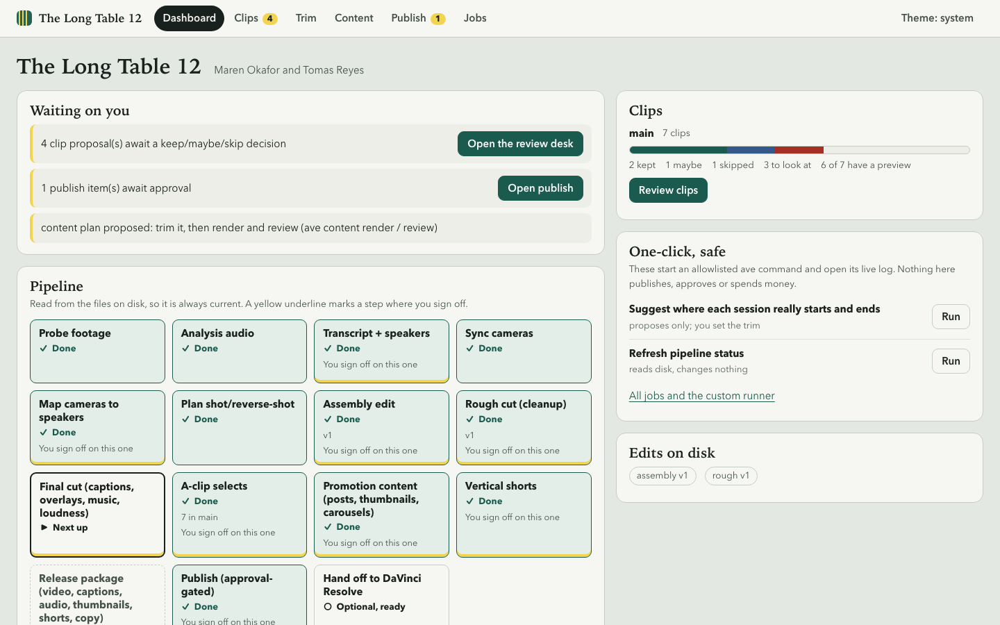

# Agentic Video Editor

A toolkit that lets an AI coding agent (Claude Code, Codex, Cursor, Gemini CLI, anything that reads `AGENTS.md`) edit a multicam podcast
while you stay the director. You drop raw footage in a folder. The agent transcribes it, labels speakers, syncs the cameras, and builds an
**assembly**, a **rough cut** and a **final cut**, then finds clips for vertical shorts and prepares a release package. It stops and asks you at
every decision that matters, and nothing is published without your approval.

The editing engine is **FFmpeg + Python**. **DaVinci Resolve** (the free version works) is optional: it is where you review a cut and tweak it
by hand. A small deterministic CLI (`ave`) does the mechanical work; plain-Markdown **skills** tell the agent when to use each command and how to
judge the result. Every stage writes a JSON file to disk, so any agent can pick up exactly where another stopped.

## See it work in a minute (no footage, only FFmpeg)

```bash
git clone https://github.com/omniharmonic/agentic-video-editor && cd agentic-video-editor
./scripts/setup.sh --minimal      # Python env via uv; tells you what to install if FFmpeg or uv are missing
.venv/bin/ave demo                # builds ./ave-demo and runs the pipeline on generated two-camera footage
```

`ave demo` generates a 30-second, two-camera, two-speaker episode (coloured frames plus tones, with known answers), then runs the real commands:
ingest, audio, sync, camera mapping, cut planning, **assembly**, **rough cut**, and a rendered draft. It prints each step, for example
`camB offset found = 1.000 s (true value 1.000) OK` and `30.0 s -> 27.2 s; 3 cuts`. It takes 10 to 30 seconds, writes only into the demo folder,
and works on Linux as well as macOS. The one stand-in is the transcript: tones are not speech, so the demo uses the generator's known transcript
and says so.



## Quick start

| | Command | You get |
|---|---|---|
| **Minimal** | `./scripts/setup.sh --minimal` | Python env + FFmpeg check. `ave demo`, the test suite, and every stage that needs only FFmpeg. |
| **Full** | `./scripts/setup.sh` | Adds extras (motion graphics, music analysis, publishing), Chromium, the Resolve MCP server, FluidAudio (Apple Silicon) or a Whisper model, and an `ave doctor` report. |

Setup never uses `sudo` and never installs system packages: if something is missing it prints the exact command. It is safe to re-run. Options:
`--skip-playwright --skip-resolve --skip-fluidaudio --with-whisper --skip-whisper`. If you prefer pip: `uv pip install .` or `pip install .` gives
the `ave` command without the setup script (see [Installing as a package](#installing-as-a-package)).

Then start your first real episode: **[docs/getting-started.md](docs/getting-started.md)**.

```bash
.venv/bin/ave doctor                              # grouped checklist with the exact fix command for anything missing, and a one-line verdict
.venv/bin/ave init-episode ~/Editing/ep-001       # creates raw/ work/ edits/ exports/ episode.json PROGRESS.md; never overwrites
# put footage in ~/Editing/ep-001/raw/, open an agent session in this repo and say:
#   "Edit episode ~/Editing/ep-001. Start with the ave-pipeline skill."
```

## What you need

| Capability | Needs | Works on |
|---|---|---|
| Demo, tests, ingest, audio, sync, cut planning, assembly, rough cut, final cut, captions, rendering, loudness, clip selection, packaging, review UI | FFmpeg + Python 3.11+ (via `uv`) | macOS, Linux (CI runs both). Windows: untested, try WSL. |
| Transcription + speaker labels, fast | **FluidAudio** (Parakeet ASR, CoreML, built from Swift by `setup.sh`; needs Xcode Command Line Tools) | **macOS, Apple Silicon only** |
| Transcription, portable fallback | **whisper.cpp** (`whisper-cli` + a ~1.6 GB model, `scripts/fetch-whisper-model.sh`) | anywhere it builds; no speaker labels of its own (speakers come from per-channel recorders or manual mapping) |
| Face-centred 9:16 crops for shorts | Apple Vision via `pyobjc` (the `vision` extra) | macOS only; elsewhere every camera falls back to a centred crop and is flagged for review |
| Faster decode of big HEVC/H.264 | VideoToolbox, used automatically when FFmpeg lists it | macOS only; software decode everywhere else |
| Motion graphics, title cards, quote reels | Playwright + Chromium (the `motion` extra) | macOS, Linux |
| Music analysis, B-roll index | `audio` / `assets` extras | macOS, Linux |
| Hand a cut to DaVinci Resolve for review | Resolve **21.0.x free** (or Studio), the pinned Resolve MCP server, a one-time `sudo` Python link, and a bridge script you start once per Resolve launch | **macOS only** (set up and tested there) |
| Publishing | the `publish` extra and your own platform credentials | anywhere; approval-gated, only mocked HTTP is tested |

`ave doctor` checks all of this for your machine and prints the exact fix for each gap. Optional gaps never block the rest.

## How an agent drives it

1. `AGENTS.md` is the entry point for every harness: Claude Code reads it through `CLAUDE.md`; Codex, Cursor, Gemini CLI and others read `AGENTS.md`
   directly. Harnesses that do not auto-load skills should read `skills/ave-pipeline/SKILL.md` first.
2. The agent starts a session with `ave doctor`, then `ave resume <episode>` (what is done, what is next, open questions) and the episode's `PROGRESS.md`.
3. Each stage has a skill (`skills/ave-*/SKILL.md`) that says when to run the command and the checklist for judging the result: look at stills,
   read the transcript, check confidence numbers, then state what it saw and how sure it is.
4. Optional, for the Resolve handoff: `ave mcp-config --write` writes an `.mcp.json` with the Resolve MCP server for harnesses that read it. Other
   harnesses can paste `ave mcp-config` output into their own MCP settings. You do not need MCP for anything else.

## Human checkpoints and safety

The agent stops for you at: speaker names, camera mapping, the assembly, the rough cut, the opening/closing plan, the final cut, which clips to use,
and anything that publishes or spends money.

- **Raw footage is read-only.** Nothing is moved, edited or deleted in your `raw/` folders. The one write is `ave proxies`, which only creates new files in a `proxies/` subfolder.
- **Edits are versioned**: `edits/<stage>.vN.json`, never overwritten. Re-running a stage is safe.
- **Nothing is published without approval.** Approval is bound to the exact file bytes and needs a human at a terminal (`ave publish approve`); the agent cannot run it. Live posting has only been tested against mocks.
- **Licenses are enforced.** Music and B-roll need a license-log entry or `ave final` refuses.
- **Resolve timelines are only ever created**, never modified.
- Your footage and episodes live outside this repo (the workspace folder); the repo's `.gitignore` also blocks media files.

## Status: what is verified and what is not

Built and run on one real two-hour, four-camera episode: ingest with sessions, transcription, drift-corrected multicam sync, assembly, rough cut, final cut
(music, captions, loudness, exact-match SRT), a few shorts, and a verified Resolve 21.0.4 handoff. Tested only on synthetic fixtures or mocks: publishing
(mocked HTTP), B-roll/music providers, the release package on a full-length episode, Canva integration, and several Resolve features (subtitles on the timeline,
proxy linking). Taste-dependent numbers (cleanup thresholds, pacing) are defaults that one person has not finished tuning. Not built: portable
(non-Apple) speaker diarization, live posting. Details and the work list are in **[docs/ROADMAP.md](docs/ROADMAP.md)**; evidence from real runs is in
[docs/field-notes/](docs/field-notes/). This is early software (alpha): expect rough edges, and please say what broke.

## FAQ and troubleshooting

**`ave: command not found`.** Use `.venv/bin/ave`, or `uv run ave ...`, or activate the venv (`source .venv/bin/activate`).

**`ffmpeg not found`.** `brew install ffmpeg` (macOS) or `sudo apt-get install ffmpeg` (Debian/Ubuntu). `ave doctor` prints the right line for your system.

**`ave transcribe` says no engine.** On Apple Silicon run `./scripts/setup.sh` (builds FluidAudio; needs `xcode-select --install`). Elsewhere install
whisper.cpp (`brew install whisper-cpp` on macOS) and run `scripts/fetch-whisper-model.sh`, then `ave transcribe <ep> --asr whisper`.

**FluidAudio build fails.** Check `swift --version`; install the Command Line Tools; re-run `./scripts/setup.sh`. Whisper works as a fallback in the meantime.

**Resolve says no scripts / handoff cannot connect.** Free Resolve 21.1 and later removed Python scripting; use 21.0.x free or Studio. After every Resolve launch,
open a project and run Workspace > Scripts > resolve_bridge. Full list in `skills/ave-setup-check/SKILL.md`.

**Do I need Resolve?** No. Everything through the final cut, shorts and the release package renders with FFmpeg. Resolve is the review-and-tweak surface.

**Where do episodes live?** Anywhere you like, outside this repo. `ave workspace <folder>` (once) lets you refer to episodes by name.

**Can I use a different AI agent?** Yes. Nothing is tied to one vendor: the contract is the CLI, the JSON artifacts and the Markdown skills.

**Where is the data when installed as a package?** Config, skills and the motion kit ship inside the wheel. Set `AVE_HOME` to a checkout to override.

## Installing as a package

```bash
uv pip install .          # or: pip install .   (a wheel build ships config/, skills/, motion-kit/, content/ inside the package)
ave --version && ave demo
```

Downloaded third-party tools (FluidAudio, the Resolve MCP server) go in `vendor/` of a checkout, or `~/.local/share/ave/vendor` for an installed copy
(override with `AVE_VENDOR`). Other overrides: `AVE_HOME`, `AVE_WORKSPACE`, `AVE_CONFIG_DIR`, `AVE_FLUIDAUDIO`, `AVE_RESOLVE_MCP`, `AVE_WHISPER_MODEL`.

## Documentation

[Getting started](docs/getting-started.md) · [Roadmap and status](docs/ROADMAP.md) · [Cleanup policy](docs/cleanup-policy.md) · [Sequences (opening/closing)](docs/sequences.md) ·
[Motion graphics](docs/motion.md) · [Review UI](docs/ui.md) · [Content](docs/content.md) · [Publishing setup](docs/publishing-setup.md) ·
[Asset licensing](docs/asset-licensing.md) · [Field notes](docs/field-notes/README.md) · [AGENTS.md](AGENTS.md) (rules and the full pipeline table)

## Development

```bash
uv sync --all-extras
uv run pytest -q -n auto          # synthetic episodes with known ground truth; no footage, no network; about 6 minutes on 8 cores with xdist; 11 serial
```

Tests that need private footage skip themselves (inputs come from `AVE_TEST_REAL_*` variables). Markers `apple`, `resolve`, `network` flag tests CI excludes.
New commands are plugins: `src/ave/commands/<name>.py` with `register(sub)`. Third-party tools are pinned in `src/ave/config.py`. MIT license.

